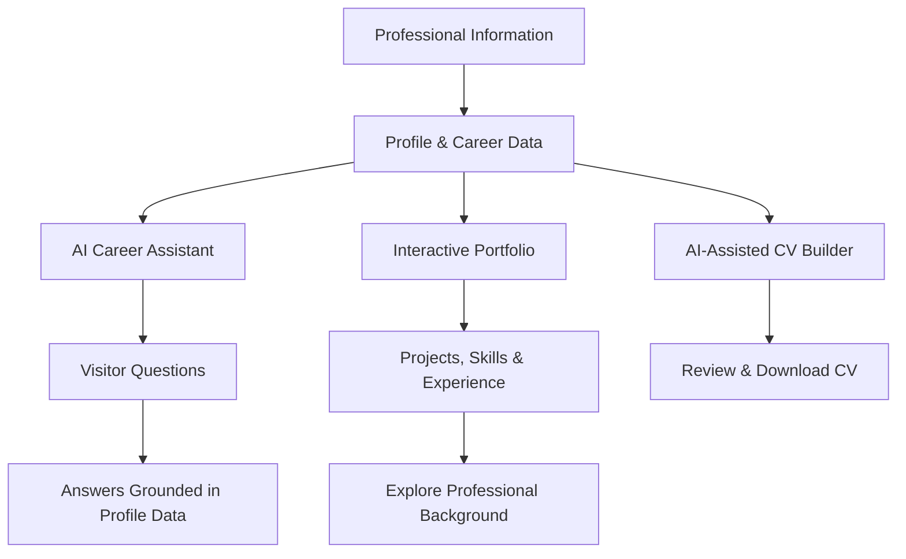

# Honger_cv — Your Career, Powered by AI

> **More than a CV. Your experience, your story, your AI.**

Honger_cv is an AI-powered career portfolio platform designed to transform a traditional CV into an interactive, intelligent professional identity.

Instead of sending a static document and hoping someone reads it, imagine sharing a personal portfolio where recruiters, interviewers, and potential collaborators can explore your experience, discover your projects, ask questions about your skills, and get answers through an AI agent that represents your professional background.

**One professional profile. An AI agent. An interactive portfolio. A smarter way to present your career.**

> Project status: 🚧 Under active development. The features and roadmap below describe the project vision; not all capabilities are implemented yet.

---

## Table of Contents

- [The Vision](#the-vision)
- [The Problem](#the-problem)
- [How It Works](#how-it-works)
- [Core Features](#core-features)
- [User Experience](#user-experience)
- [System Architecture](#system-architecture)
- [AI Agent Workflow](#ai-agent-workflow)
- [Development Roadmap](#development-roadmap)
- [Design Principles](#design-principles)
- [Getting Started](#getting-started)
- [Project Status](#project-status)
- [Future Possibilities](#future-possibilities)
- [Contributing](#contributing)

---

## The Vision

A CV should be more than a list of qualifications, job titles, and responsibilities. It should tell a story about what someone has built, what they know, how they think, and what they can contribute.

Honger_cv brings that story to life.

Users provide their professional information, including their skills, education, work experience, achievements, and projects. The platform organizes that information into a professional profile that can power an AI assistant and an interactive portfolio.

Visitors can explore the portfolio themselves or ask the AI agent questions such as:

- What projects has this person worked on?
- What technologies do they have experience with?
- What were their responsibilities in their previous role?
- Can you explain one of their projects?
- What makes this candidate a good fit for a particular position?
- Can I download their CV?

The goal is to make professional information easier to explore, understand, and remember.

## The Problem

Traditional CVs have limitations:

| Traditional CV                                  | Honger_cv vision                            |
| ----------------------------------------------- | ------------------------------------------- |
| Static document                                 | Interactive professional experience         |
| Limited space for project details               | Dedicated sections for deeper exploration   |
| Recruiters must search manually                 | Visitors can ask questions conversationally |
| One document may not fit every opportunity      | AI-assisted CV creation and customization   |
| Professional background is difficult to explore | AI-guided discovery of relevant experience  |
| Text-only presentation                          | Future voice-enabled interactions           |

Honger_cv aims to bridge the gap between presenting qualifications and actually demonstrating professional capabilities.

---

## How It Works

The platform revolves around three connected experiences.

### 1. Build your professional identity

The user supplies structured information about their professional background: personal introduction, education, work experience, technical skills, projects, achievements, and career interests.

That information becomes the foundation for the portfolio and AI assistant.

### 2. Generate and organize career content

The platform is designed to use AI to help organize professional information, draft CV content, and present experience clearly. Users should be able to review and refine generated content before sharing it.

### 3. Share your AI-powered portfolio

The user shares a public portfolio link. Visitors can browse the professional sections, ask the AI agent questions about the person's background, and access the available CV.

---

## Core Features

The following describes the intended feature set. Implementation status may vary as development progresses.

### AI Career Assistant

A conversational AI agent that answers questions about a person's professional background using the information provided by that person.

**Key goals:**

- Answer questions about skills, education, work experience, and projects.
- Explain projects in more detail than a short CV entry allows.
- Help visitors discover relevant experience.
- Keep responses grounded in the available professional profile.
- Avoid inventing qualifications, achievements, or work experience.
- Provide useful responses when information is missing instead of making assumptions.

The assistant is intended to act as a professional representative of the user's career information—not as an unrestricted chatbot that makes claims on their behalf.

### AI-Powered CV Builder

A system designed to turn structured career information into a polished CV.

Planned capabilities include:

- Organize education, experience, skills, and projects.
- Improve clarity and professional wording.
- Generate structured CV content.
- Support review and editing before publication.
- Explore role-specific CV customization.
- Provide a downloadable CV in a suitable document format.

The objective is to help users communicate their actual experience effectively, without fabricating qualifications or achievements.

### Interactive Portfolio

A navigable professional website where visitors can explore different areas of a person's career.

Potential sections include:

- **About Me** — professional introduction and career interests.
- **Experience** — roles, responsibilities, and accomplishments.
- **Projects** — project descriptions, technologies, and outcomes.
- **Skills** — technical and professional capabilities.
- **Education** — academic background and relevant learning.
- **Achievements** — certifications, awards, and milestones.
- **CV** — access to the available professional document.
- **AI Assistant** — a conversational way to explore the profile.

Each section should provide useful information independently while remaining connected to the AI assistant.

### Public Portfolio Link

Every published profile is intended to have a shareable URL.

Users could include this link in:

- Job applications
- LinkedIn profiles
- GitHub repositories
- Professional emails
- Personal websites
- Networking messages

The goal is to make a person's professional identity accessible from a single link.

### Voice-Enabled AI Assistant

Voice interaction is part of the planned experience.

Visitors could eventually speak their
