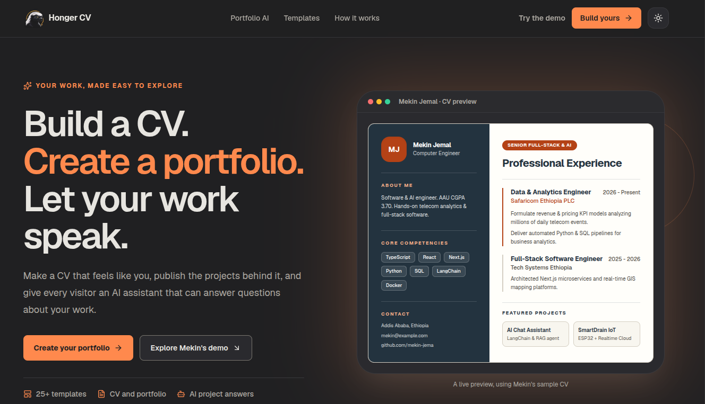
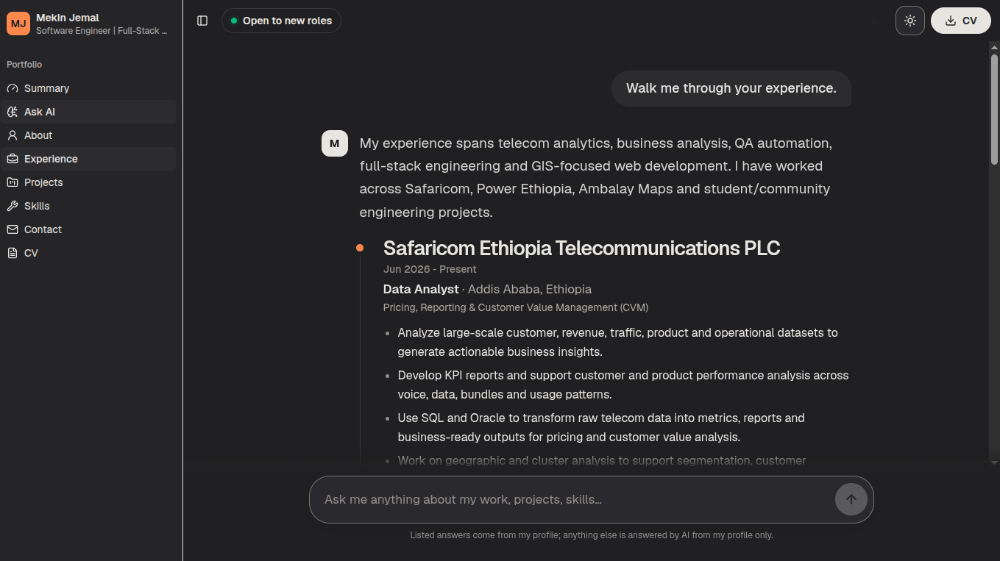
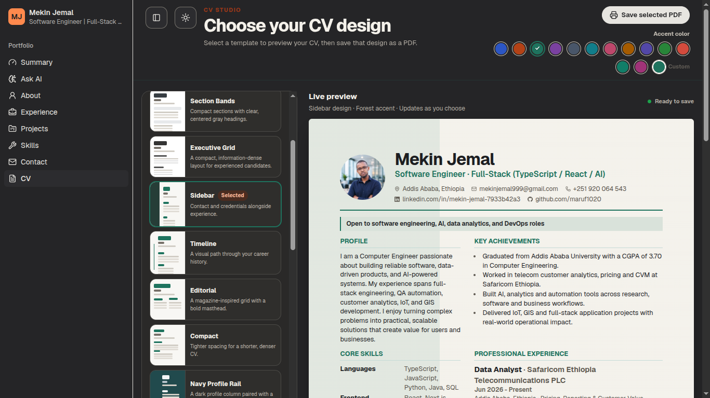
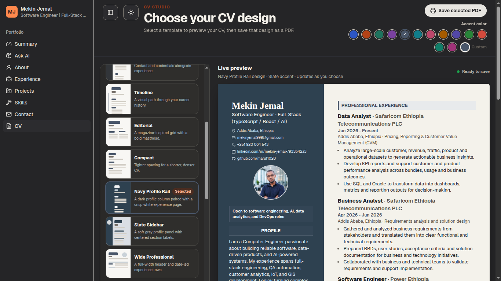
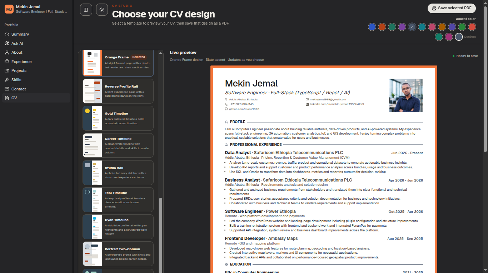

<div align="center">

# Honger CV

### A portfolio you can explore like a conversation.

An interactive portfolio and CV with a conversational assistant, project stories, and a private admin workspace — built with Next.js, React, Tailwind CSS, and shadcn/ui.

<br />


</div>

---

## The idea

Most portfolios are a stack of pages. **Honger CV is a portfolio you can ask questions of.**

Visitors can follow curated topics or ask the assistant about work, skills, projects, and experience. Each answer can include useful details and a link to the corresponding public page. A separate dashboard provides a career overview, while the protected admin workspace brings visitor messages, feedback, votes, analytics, and persona editing together.

The portfolio and curated answers work without a database or AI credentials. PostgreSQL unlocks persistent features; a Gemini API key enables optional generated answers.

## Product tour

### Build a portfolio from your CV

Start with a polished CV, explore the templates, or open Mekin's public demo.



### Ask the portfolio

Visitors can ask about experience and projects, then explore the supporting details in the conversation.



### Choose a CV design

Preview the same CV across a collection of layouts and accent colors before saving it as a PDF.







## Explore

| Route | What you’ll find |
| --- | --- |
| `/` | CV Studio landing page with 25+ CV design options |
| `/ask/` | AI-powered conversational portfolio |
| `/ask/[intent]/` | Shareable chat answer for a topic |
| `/dashboard/` | Career summary and selected work |
| `/about/` | Profile and background |
| `/experience/` | Professional experience |
| `/projects/` | Project cards and case studies |
| `/skills/` | Technologies and capabilities |
| `/contact/` | Contact details and message form |
| `/cv/` | Printable CV and PDF download |
| `/admin/` | Private inbox, analytics, and visitor activity |
| `/admin/personas/` | Persona management and content studio |

The CV Studio landing page is the public home page. The **Open CV Studio** action opens the template picker and PDF preview; **Ask AI** opens the conversational portfolio. The public portfolio pages use their own site navigation rather than the dashboard sidebar; **Summary** opens the career dashboard.

## What’s inside

- **Conversational portfolio** — curated, source-grounded answers, follow-up prompts, feedback controls, and optional AI responses.
- **Project storytelling** — full-width project covers, summaries, technology stacks, and detailed case studies.
- **CV Studio** — 25+ layouts, custom accent colors, live previews, and print-ready PDF export.
- **CV and public pages** — responsive About, Experience, Projects, Skills, and Contact pages, plus a downloadable PDF.
- **Admin inbox** — review messages, feedback, answer votes, AI answers, and visitor activity.
- **Privacy-first analytics** — aggregated traffic and engagement insights; visitor-level analytics are available only when consent is given.
- **Persona Studio** — edit persona content, review changes, run checks, manage access, and publish.
- **Light and dark themes** — theme-aware components throughout the portfolio and admin.
- **Accessible interactions** — keyboard focus, reduced-motion support, labels, and responsive layouts.

## Quick start

### Requirements

- [Bun](https://bun.sh/) 1.4.3 (the project’s package manager)
- Node.js 20.9 or later
- PostgreSQL for persistent data and admin features

### Install and run

```bash
git clone https://github.com/Mekin-jema/honger_cv.git
cd honger_cv
bun install
cp .env.example .env.local
bun run dev
```

Open [http://localhost:3000](http://localhost:3000). The portfolio and curated chat work without filling in the optional environment settings. Add PostgreSQL and admin settings to `.env.local` to enable persistence and the admin workspace.

> **Keep `.env.local` private.** Never commit credentials or expose server secrets through a `NEXT_PUBLIC_` variable.

## Configuration

| Variable | Required for | Notes |
| --- | --- | --- |
| `DATABASE_URL` | Persistent features and admin | PostgreSQL connection string. Schema migrations are applied automatically when the server starts; you can also run them explicitly. |
| `BETTER_AUTH_SECRET` | Admin authentication | Use a private secret of at least 32 characters. |
| `BETTER_AUTH_URL` | Admin authentication | Public app origin with no path, for example `http://localhost:3000` locally or `https://honger-cv.vercel.app` in production. |
| `GOOGLE_CLIENT_ID` | Google customer sign-in | OAuth client ID. Configure the callback URI as `<BETTER_AUTH_URL>/api/auth/callback/google`. |
| `GOOGLE_CLIENT_SECRET` | Google customer sign-in | OAuth client secret; keep it server-side. |
| `GITHUB_CLIENT_ID` | GitHub customer sign-in | OAuth app client ID. Grant the `user:email` scope and configure `<BETTER_AUTH_URL>/api/auth/callback/github`. |
| `GITHUB_CLIENT_SECRET` | GitHub customer sign-in | OAuth app client secret; keep it server-side. |
| `PERSONA_SIGNING_SECRET` | Signed persona access and preview tokens | Use a private secret of at least 32 characters. |
| `NEXT_PUBLIC_SITE_URL` | Canonical metadata and sitemap | Public HTTPS origin in production, normally the same origin as `BETTER_AUTH_URL`. Defaults to localhost for local development. |
| `GEMINI_API_KEY` | Optional generated answers | Without it, curated answers remain available. |
| `NEXT_PUBLIC_CLOUDINARY_CLOUD_NAME` | Customer CV photo uploads | Public cloud name from the Cloudinary dashboard. |
| `CLOUDINARY_API_KEY` | Customer CV photo uploads | Cloudinary API key; used only by the server. |
| `CLOUDINARY_API_SECRET` | Customer CV photo uploads | Cloudinary API secret; keep private and never prefix it with `NEXT_PUBLIC_`. |
| `NEXT_PUBLIC_CLOUDINARY_UPLOAD_PRESET` | Optional unsigned image uploads | Not used by the current signed server upload route; leave blank unless a restricted unsigned upload is deliberately added. |
| `MAIL_PROVIDER` | Email delivery for sign-in codes | `resend`, `log`, or `none`. Production email needs `RESEND_API_KEY` and `MAIL_FROM`. |
| `RESEND_API_KEY` | Resend email delivery | Needed when `MAIL_PROVIDER=resend`. |
| `MAIL_FROM` | Resend email delivery | Verified sender address for outgoing sign-in codes. |
| `ADMIN_OTP_STATIC` | Local-only sign-in convenience | Fixed code for development only. Remove it for production and configure email delivery. |
| `NEXT_PUBLIC_BASE_PATH` | Sub-path deployments | Optional URL prefix when hosting below the domain root. |

To generate strong signing secrets, use a secure random generator, for example:

```bash
openssl rand -base64 32
```

Set the generated value for each secret independently. Do not reuse a production secret in development or commit it to the repository.

### Customer CV photos

Create a Cloudinary account and add its cloud name, API key, and API secret to `.env.local` for local development and to the Vercel project's Production environment for deployment. Customer uploads are accepted only for authenticated CV owners and are limited to JPG, PNG, and WebP images up to 3 MB. The server verifies the file signature, stores the image in that customer's Cloudinary folder, and serves a resized, automatically optimized secure URL. The server signs uploads; `CLOUDINARY_API_SECRET` is never included in browser code. `NEXT_PUBLIC_CLOUDINARY_UPLOAD_PRESET` is included in the template for configuration compatibility but is not required by this signed upload flow.

### Source CV uploads

Uploaded source PDFs are validated and sent directly to the configured Gemini service for mapping into the existing CV form. The PDF is held in request memory for processing and isn't retained in a file store. The reviewed CV fields and Cloudinary photo URL/public ID are saved with the persona's existing JSON document in Neon PostgreSQL.

### Neon PostgreSQL

The app already uses Neon-compatible PostgreSQL through the `pg` connection pool and its existing ordered SQL migration system; it does not use Drizzle or Prisma. Keep the existing `DATABASE_URL` unchanged. For a serverless deployment, use the Neon pooled connection string from the Neon dashboard. Migrations are additive and run through the app's existing migration runner; no database is reset or recreated.

For Vercel, set `BETTER_AUTH_URL` and `NEXT_PUBLIC_SITE_URL` in the project's Production environment to the exact deployed origin, such as `https://honger-cv.vercel.app` (no trailing text or path), then redeploy. Keep the localhost values in your local `.env.local`; Vercel does not use that file for its project environment variables.

### Create the admin account

With `DATABASE_URL`, `BETTER_AUTH_SECRET`, and `BETTER_AUTH_URL` configured, create the single admin account:

```bash
bun run admin:create -- --email you@example.com
```

The script prompts for a password without displaying it, enables two-factor authentication, and prints backup codes once. Save those codes securely. Sign in at `/admin/login/`.

Admin links are hidden from non-admin visitors, but authorization is also enforced on admin pages and API routes.

### Customer accounts and profiles

Customers can register at `/register/`, sign in at `/login/`, and manage their CVs from `/account/`. Each customer can create Job CVs by entering a professional role; the role names the CV (for example, “Product Engineer CV” or “Product Engineer CV 2”). New CVs start from Mekin's public demo profile as editable sample information, not from an empty document. **Edit CV** opens the 25-template picker first, then the complete CV form; the customer can also edit all profile data in the Studio's JSON tab. The customer Studio uses all nine Persona Studio tabs, including JSON, with owner-scoped APIs for drafts, AI helpers, checks, access management, and publishing. Their sidebar includes the public Portfolio navigation plus links to their own dashboard, AI, training, and CV form/design. The CV form saves to that customer's draft and is used by their own CV page and AI knowledge. Admins keep the same Portfolio sidebar and receive the administration links; the admin navigation label is **User**.

Customer login and registration support Google and GitHub when the matching client ID and secret are configured. Register each callback URI with the provider, including `/api/auth/callback/google` or `/api/auth/callback/github` after the app origin (and any configured base path). For GitHub OAuth Apps, Better Auth requests `user:email`; for GitHub Apps, grant **Account permissions → Email addresses → Read-only** as well. OAuth may link to an existing customer account only when the provider verifies the matching email. Admin accounts cannot be linked to social providers; administrators continue to use email/password plus the existing email verification code. OAuth state and session cookies use `SameSite=Lax` to support the cross-site callback and its immediate redirect; all other auth cookies remain `SameSite=Strict`.

The private assistant is available after the customer first publishes and trains the CV. Before then, Ask AI explains that the user must add or edit information with the forms or JSON editor, then choose **Publish & train**. Published profiles are available at `/u/<profile-slug>/`, where their CV and public AI assistant use the saved profile and design. The existing Mekin portfolio remains the public demo. Customer requests cannot access the shared `/admin/personas/job/` editor or another owner's persona.

Persona ownership is checked on customer APIs, publishing jobs, and profile pages. Platform event totals are visible only to administrators in the `/admin/` dashboard. Apply the pending migrations before enabling customer registration in an existing deployment.

### Database migrations

The server applies pending migrations at startup. To run them manually or check migration status:

```bash
bun run db:migrate
bun run db:migrate -- --check
```

## Commands

| Command | Description |
| --- | --- |
| `bun run dev` | Start the local development server |
| `bun run build` | Create a production build |
| `bun run start` | Serve the production build |
| `bun run typecheck` | Run the TypeScript compiler without emitting files |
| `bun run lint` | Run ESLint |
| `bun run test` | Run the test suite |
| `bun run check` | Run typecheck, lint, tests, and production build |
| `bun run db:migrate` | Apply pending PostgreSQL migrations |
| `bun run admin:create -- --email you@example.com` | Create the admin account |
| `bun run cv:pdf` | Generate the downloadable CV PDF |

To generate the PDF, build the app first and then run `bun run cv:pdf`. The script uses Chrome or Edge when available, or Firefox with geckodriver. Set `CHROME_PATH` or `GECKODRIVER_PATH` if the browser executable is not on the standard path.

## Repository structure

```text
.
├── app/                              Next.js App Router: pages, layouts, and API routes
│   ├── (site)/                       Public portfolio pages
│   │   ├── about/
│   │   ├── contact/
│   │   ├── experience/
│   │   ├── projects/
│   │   └── skills/
│   ├── account/                      Signed-in customer workspace
│   │   ├── ai/[slug]/                Customer AI chat
│   │   └── training/[slug]/          CV editor, JSON studio, and training
│   ├── admin/                        Admin dashboard and persona studio
│   ├── api/                          Authentication, account, admin, and chat endpoints
│   ├── ask/                          Conversational portfolio
│   ├── cv/                           Public CV studio and PDF preview
│   ├── dashboard/                    Career overview
│   ├── login/  register/             Customer authentication pages
│   ├── u/[slug]/                     Published customer profiles
│   ├── layout.tsx                   Root layout and metadata
│   └── page.tsx                     Landing page
├── components/
│   ├── account/                      Customer CV, training, and account UI
│   ├── admin/studio/                 Persona editing, checks, JSON, and publishing
│   ├── chat/                         Chat messages, composer, and suggestions
│   ├── document/                     CV sheet and print styles
│   ├── landing/                      Landing page sections and template showcase
│   ├── site/                          Public persona and site shells
│   └── ui/                            Shared interface primitives
├── content/                           Typed portfolio, CV, project, and experience data
├── hooks/                             Shared React hooks
├── lib/
│   └── persona/                       Persona schemas, CV mapping, and shared logic
├── migrations/                        PostgreSQL schema migrations
├── public/
│   ├── images/                        Portfolio and CV images
│   └── ...                            Logos, icons, and downloadable CV
├── scripts/                           Admin, database, and PDF utilities
├── server/
│   ├── access/                        Access codes and gated content
│   ├── brain/                         AI answers, retrieval, and safety checks
│   └── persona/                       Persona data, publishing, and CV services
├── *.config.*                          Build, lint, test, and TypeScript configuration
├── package.json                        Scripts and dependencies
└── README.md                           Setup, configuration, commands, and this map
```

The tree highlights the main source areas rather than every file. Public portfolio facts live in the typed modules under `content/`; customer and admin CV workflows are built from `app/account/`, `components/account/`, and `components/admin/studio/`. Shared persona validation and CV transformations are in `lib/persona/`, while persistence, AI training, and publishing are handled in `server/`.

## Tech stack

**App:** Next.js 16 · React 19 · TypeScript · Tailwind CSS 4 · shadcn/ui<br />
**Interface:** Base UI · Motion · GSAP · Lucide<br />
**Services:** PostgreSQL · Better Auth · Vercel AI SDK · Google Gemini<br />
**Quality:** Vitest · ESLint · TypeScript

## Security notes

- Keep database credentials, auth secrets, and AI keys on the server.
- `NEXT_PUBLIC_` variables are bundled for browser use; never use that prefix for secrets.
- `ADMIN_OTP_STATIC` is for local development only.
- Admin routes and API handlers enforce authorization independently of sidebar visibility.
- The app sets security headers, including a Content Security Policy and anti-framing protections.

---

<div align="center">

Built by **Mekin Jemal** · [GitHub](https://github.com/Mekin-jema/honger_cv)

</div>
